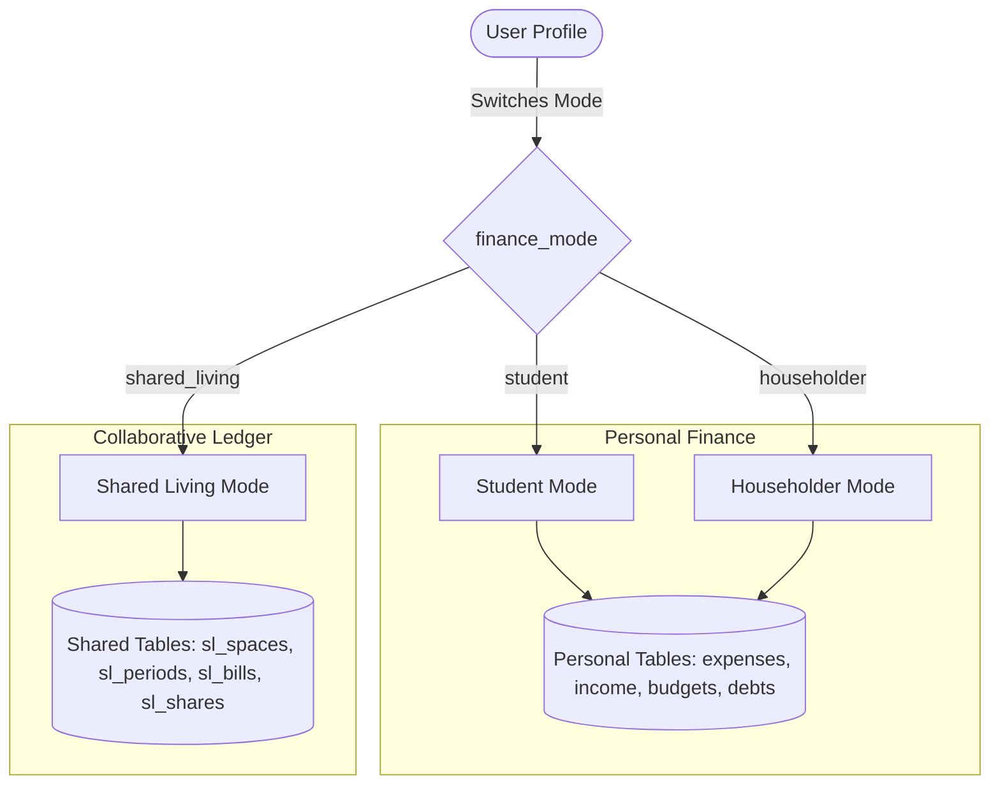

# Hisabki Kitab — Project Analysis, Modes & Models Guide

## 1. Executive Summary

**Hisabki Kitab** is a full-stack financial management platform purpose-built for university hostel students, domestic household managers, and shared roommate spaces in Pakistan. 

Unlike conventional Western personal finance applications that assume corporate salaries, mortgage payments, credit score monitoring, and stock portfolios, Hisabki Kitab is engineered for the economic realities of Pakistan:
- Limited monthly pocket money (Rs 15,000 – Rs 35,000) or household salaries.
- High-frequency micro cash and mobile wallet transactions (Cash, JazzCash, Easypaisa, Raast).
- Hostel-specific obligations (mess food charges, canteen chai, shared rickshaw fares, photocopy handouts).
- Household obligations (WAPDA/K-Electric bijli bills, Sui gas, water tankers, rashan, school fees, committees).
- Collaborative flatmate/hostel room expenses with exact paisa split algorithms.
- Full bilingual presentation: English and Roman Urdu (`roman_ur`).

---

## 2. Monorepo Architecture & Tech Stack

```
hisabki-kitab/
├── apps/
│   ├── api/                    # Express.js REST API (Node.js, CommonJS)
│   │   ├── server.js           # Server entry point
│   │   └── src/
│   │       ├── app.js          # Express app configuration & middlewares
│   │       ├── routes.js       # Central router mounting
│   │       ├── infrastructure/ # PostgreSQL pool, database helpers, AI client
│   │       ├── modules/        # Feature modules (auth, expenses, debts, etc.)
│   │       └── shared/         # Constants, utilities, rate limiters
│   └── web/                    # React 18 SPA (Vite, Tailwind CSS, ESM)
│       └── src/
│           ├── app/            # App shell, routing, layout, providers
│           ├── features/       # Domain UI features (dashboard, debts, advisor)
│           └── shared/         # Reusable UI primitives, i18n hooks, analytics
├── packages/
│   └── contracts/              # Shared schemas, catalogues, vocabulary, validations
├── database/
│   ├── migrations/             # Idempotent forward-only SQL migrations
│   └── seeds/                  # Seed scripts for development and demo mode
└── docs/                       # Project documentation, runbooks, and audit logs
    ├── modes/                  # Dedicated documentation for each Finance Mode
    └── models/                 # Dedicated documentation for each Domain Model
```

### Technology Matrix:
| Layer | Technologies |
|---|---|
| **Frontend** | React 18, Vite, Tailwind CSS, React Router v6, Recharts, Axios, React Hook Form, Zod, Lucide Icons |
| **Backend** | Node.js, Express, JWT (Access + Refresh tokens), bcryptjs, express-validator, Helmet, CORS |
| **Database** | PostgreSQL (Supabase), parameterized raw SQL (`pg`), versioned transactional migrations |
| **AI Layer** | Claude 3.5 (Anthropic Messages API) + Google Gemini API + Rule-Based deterministic engine fallback |
| **Precision Math** | Exact minor currency integer units (`bigint amount_minor` / paisas) and SQL `numeric(14,2)` |
| **Localization** | Dynamic English (`en`) & Roman Urdu (`roman_ur`) via zero-drift catalogue contract |

---

## 3. The 3 Financial Modes (طریقہ کار / Modes)

Hisabki Kitab partitions user financial records into three distinct operating **Modes**:



### Detailed Mode Documentation Files:
1. **[Student Mode Documentation](file:///d:/hostel-assinstent/docs/modes/STUDENT_MODE.md)**:
   - For university hostel students.
   - Metrics: Safe Daily Spend (Rozana kharch ki had), mess bills, canteen chai, Daewoo fares, mobile cards.
   - Persona: Practical senior hostel mentor.
2. **[Householder Mode Documentation](file:///d:/hostel-assinstent/docs/modes/HOUSEHOLDER_MODE.md)**:
   - For family and household heads.
   - Metrics: Committed vs discretionary income, electricity/gas/water bills, monthly rashan, school fees, committees.
   - Persona: Prudent domestic financial advisor.
3. **[Shared Living Mode Documentation](file:///d:/hostel-assinstent/docs/modes/SHARED_LIVING_MODE.md)**:
   - For roommates and flatmates sharing an apartment or hostel room.
   - Features: Space creation, invite links, monthly accounting periods, receipt uploads, split algorithms (Equal, Selected, Weighted, Percentage, Custom).
4. **[Demo Mode Documentation](file:///d:/hostel-assinstent/docs/modes/DEMO_MODE.md)**:
   - Read-only demonstration sandbox for all three finance modes.
   - Multi-layer defense: Frontend action suppression, Express API middleware, and database-level trigger rejections.

---

## 4. The Domain Models & Subsystems (ماڈلز / Models)

Every core domain entity and subsystem in Hisabki Kitab is thoroughly analyzed in its dedicated documentation file:

| Model Document | Database Tables | Scope & Key Invariants |
|---|---|---|
| **[User & Auth Model](file:///d:/hostel-assinstent/docs/models/USER_AND_AUTH_MODEL.md)** | `users`, `refresh_tokens` | Identity, bcrypt passwords, JWT + rotated refresh cookie with grace period, Google OAuth, language & mode settings. |
| **[Expenses Model](file:///d:/hostel-assinstent/docs/models/EXPENSES_MODEL.md)** | `expenses` | Categorized spending, payment methods, recurring sweeps via cron, `amount_minor bigint` exact currency. |
| **[Income Model](file:///d:/hostel-assinstent/docs/models/INCOME_MODEL.md)** | `income` | Inflow tracking, pocket money vs salary, mode-specific income sources, realized cashflow vs anticipated income. |
| **[Budgets Model](file:///d:/hostel-assinstent/docs/models/BUDGETS_MODEL.md)** | `budgets` | Monthly category limits, 80% warning and 100% exceeded thresholds, atomic bulk upserts for AI plans. |
| **[Goals Model](file:///d:/hostel-assinstent/docs/models/GOALS_MODEL.md)** | `goals`, `goal_contributions` | Mode-agnostic personal savings milestones, auditable ledger, automated completion tracking, target pacing. |
| **[Debts (Udhaar) Model](file:///d:/hostel-assinstent/docs/models/DEBTS_UDHAAR_MODEL.md)** | `debts`, `debt_payments`, `debt_contacts` | Borrowed vs Lent, exact `numeric(14,2)` arithmetic, row-level locks, dynamic read-time overdue derivation. |
| **[Shared Living Models](file:///d:/hostel-assinstent/docs/models/SHARED_LIVING_MODELS.md)** | `sl_spaces`, `sl_members`, `sl_periods`, `sl_bills`, `sl_expenses`, `sl_shares`, `sl_payments`, `sl_receipts`, `sl_activity`, `financial_requests` | Multi-tenant space accounting, Largest Remainder Hare-Niemeyer split math, deferred triggers, audit ledger, receipt images. |
| **[AI Advisor Model](file:///d:/hostel-assinstent/docs/models/AI_ADVISOR_MODEL.md)** | `chat_messages` (Server-side LLM & fallback) | Claude + Gemini + Rule-based fallback, student vs householder prompts, structured JSON recommendations, persisted chat history. |
| **[Notifications & Reports Model](file:///d:/hostel-assinstent/docs/models/NOTIFICATIONS_AND_REPORTS_MODEL.md)** | `notifications` | Deduplicated alert bell, metadata-driven on-the-fly translation, PDF generation via `pdfkit`, CSV export. |
| **[Feedback Model](file:///d:/hostel-assinstent/docs/models/FEEDBACK_MODEL.md)** | `feedback` | In-app user ratings and feedback, database persistence before email dispatch, zero friction. |
| **[System Infrastructure & Security Model](file:///d:/hostel-assinstent/docs/models/SYSTEM_INFRASTRUCTURE_AND_SECURITY_MODEL.md)** | `rate_limits`, `financial_requests` | Distributed SHA-256 rate limits, mutation idempotency, token family rotation, defense-in-depth SQL triggers. |
| **[Public Content, Tools & Trust Modules](file:///d:/hostel-assinstent/docs/models/PUBLIC_CONTENT_AND_TOOLS_MODULE.md)** | Frontend / Pre-rendered | 10 financial education articles (English & Roman Urdu), interactive web calculators, privacy, terms, disclaimer. |

---

## 5. Modes vs. Models Matrix

The matrix below illustrates how each model functions across the 3 modes:

| Model / Feature | Student Mode | Householder Mode | Shared Living Mode |
|---|---|---|---|
| **Primary Identifier** | `user_id` + `finance_mode='student'` | `user_id` + `finance_mode='householder'` | `space_id` + `period_id` |
| **Expenses** | Mess, Canteen, Books, Transport, Mobile | Groceries, Rent, Utilities, Domestic Help | Shared food, drinking water, apartment upkeep |
| **Income** | Pocket Money, Part-time, Scholarship | Salary, Business, Rent, Pension | Space member contributions & payments |
| **Budgets** | Per-category pocket money limits | Per-category household limits | Monthly space overall spending budget |
| **Goals** | Active (Shared across personal modes) | Active (Shared across personal modes) | Not applicable |
| **Debts (Udhaar)** | Peer micro-loans, canteen dhabba khata | Family loans, committee installments | Net balances computed automatically |
| **AI Advisor Persona** | Friendly hostel senior mentor | Prudent household financial counselor | Disabled (Ledger math strictly applies) |
| **Direct Routes** | Personal API (`/api/expenses`, etc.) | Personal API (`/api/expenses`, etc.) | Dedicated API (`/api/shared-living/*`) |

---

## 6. Security, Integrity & Data Preservation Invariants

1. **Zero Data Loss on Mode Switching**: Switching between `student` and `householder` mode updates `users.finance_mode`. All past records remain untouched in the database with their respective `finance_mode` intact.
2. **Personal / Shared Segregation Guard**: If a user switches to `shared_living` mode, any requests to personal financial endpoints are blocked by Express middleware (`403 Forbidden: shared.personalMode`), protecting data boundaries.
3. **Paisa-Level Arithmetic Integrity**:
   - Debts use PostgreSQL `numeric(14,2)` arithmetic directly in SQL.
   - Shared Living and Personal Money use `bigint amount_minor` (cents/paisas) to eliminate floating-point rounding errors.
   - Database constraint triggers (`sl_shares_total`, `sl_expenses_total`) guarantee that split shares match total amounts down to the exact paisa.
4. **Catalogue Contract & Translation Safety**: Category IDs in the database are immutable English slugs or legacy strings (e.g., `Mess/Food`, `groceries`). Translations (`en` and `roman_ur`) are applied solely at presentation boundaries, preventing data drift or duplicate categories.
