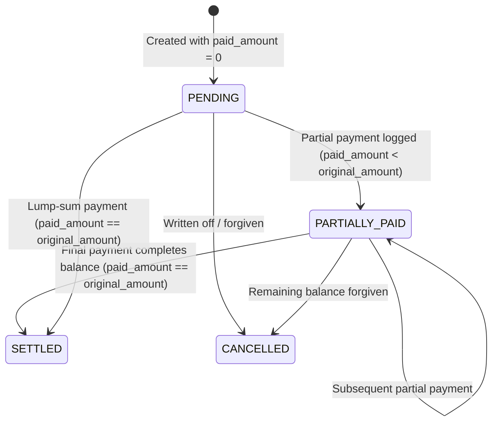

# Debts (Udhaar) Model Documentation

## 1. Overview
The **Debts (Udhaar)** model manages informal borrowing and lending (*Qarz / Udhaar*), which is pervasive in hostel life and domestic living across Pakistan. It tracks money borrowed from peers, money lent to roommates or family, installment repayments, contact details, and settlement statuses.

---

## 2. Database Schema

### Table: `debts`
```sql
CREATE TABLE IF NOT EXISTS debts (
  id                uuid PRIMARY KEY DEFAULT gen_random_uuid(),
  user_id           uuid NOT NULL REFERENCES users(id) ON DELETE CASCADE,
  finance_mode      text NOT NULL DEFAULT 'student' CHECK (finance_mode IN ('student', 'householder')),
  kind              text NOT NULL CHECK (kind IN ('BORROWED', 'LENT')),
  person_name       text NOT NULL CHECK (length(btrim(person_name)) BETWEEN 1 AND 80),
  person_contact    text NOT NULL DEFAULT '' CHECK (length(person_contact) <= 120),
  contact_id        uuid REFERENCES debt_contacts(id),
  original_amount   numeric(14,2) NOT NULL CHECK (original_amount > 0),
  paid_amount       numeric(14,2) NOT NULL DEFAULT 0 CHECK (paid_amount >= 0 AND paid_amount <= original_amount),
  status            text NOT NULL DEFAULT 'PENDING' CHECK (status IN ('PENDING', 'PARTIALLY_PAID', 'SETTLED', 'CANCELLED')),
  transaction_date  timestamptz NOT NULL DEFAULT now(),
  due_date          timestamptz,
  settled_at        timestamptz,
  purpose           text NOT NULL DEFAULT '',
  purpose_category  text,
  created_at        timestamptz NOT NULL DEFAULT now(),
  updated_at        timestamptz NOT NULL DEFAULT now()
);
```

### Table: `debt_payments`
```sql
CREATE TABLE IF NOT EXISTS debt_payments (
  id          uuid PRIMARY KEY DEFAULT gen_random_uuid(),
  debt_id     uuid NOT NULL REFERENCES debts(id) ON DELETE CASCADE,
  amount      numeric(14,2) NOT NULL CHECK (amount > 0),
  date        timestamptz NOT NULL DEFAULT now(),
  note        text NOT NULL DEFAULT '',
  created_at  timestamptz NOT NULL DEFAULT now()
);
```

### Table: `debt_contacts`
```sql
CREATE TABLE IF NOT EXISTS debt_contacts (
  id            uuid PRIMARY KEY DEFAULT gen_random_uuid(),
  user_id       uuid NOT NULL REFERENCES users(id) ON DELETE CASCADE,
  display_name  text NOT NULL,
  contact_info  text NOT NULL DEFAULT '',
  created_at    timestamptz NOT NULL DEFAULT now(),
  updated_at    timestamptz NOT NULL DEFAULT now(),
  UNIQUE (user_id, lower(display_name))
);
```

---

## 3. Critical Architectural Decisions

### 1. `numeric(14,2)` Exact Arithmetic vs `double precision`
While general expenses use floating-point numbers rounded at presentation boundaries, debt settlement demands **exact penny/paisa precision**:
- If someone pays three installments of PKR 33.33 against a PKR 100 debt, floating-point arithmetic can produce $99.99000000000001$.
- `numeric(14,2)` implemented directly in SQL ensures payments add up to exact sums and that `remaining_amount == 0` is strictly verifiable.

### 2. Pessimistic Row Locking on Payments
When a payment is logged, the repository issues `SELECT ... FROM debts WHERE id = $1 FOR UPDATE`. This locks the row against concurrent race conditions, preventing two simultaneous repayments from overwriting each other's balances.

### 3. Dynamic "OVERDUE" Computation (Read-Time Derivation)
`OVERDUE` is **never stored as a static column**. If it were stored, a cron job would have to wake up at midnight every day to update rows. Instead, it is computed on read:
$$\text{is\_overdue} = (\text{status} \notin (\text{'SETTLED'}, \text{'CANCELLED'}) \land \text{due\_date} < \text{now}())$$

---

## 4. Status Lifecycle



---

## 5. Vocabulary & Presentation (English & Roman Urdu)

| Kind / Status | English Label | Roman Urdu Label | Description |
|---|---|---|---|
| `BORROWED` | I Have to Pay | Mujhe Paise Dene Hain | Student/householder owes money to another person |
| `LENT` | I Have to Receive | Mujhe Paise Lene Hain | Another person owes money to the student/householder |
| `PENDING` | Pending | Baqi | No payments made yet |
| `PARTIALLY_PAID` | Partially Paid | Kuch Ada Shuda | Some payments made, balance remains |
| `SETTLED` | Settled | Chuka Diya | Balance fully cleared |
| `CANCELLED` | Cancelled / Written Off | Maaf / Khatam | Debt waived or written off |

---

## 6. API Endpoints

| Method | Path | Description | Protected |
|---|---|---|:---:|
| `GET` | `/api/debts` | List debts with filters (`kind`, `status`, `search`, `dueFrom`, `dueTo`) | Yes |
| `POST` | `/api/debts` | Create a new debt record | Yes |
| `GET` | `/api/debts/:id` | Get debt details including all payment history | Yes |
| `PATCH` | `/api/debts/:id` | Update debt notes, due date, or contact | Yes |
| `DELETE` | `/api/debts/:id` | Delete debt and its payments | Yes |
| `POST` | `/api/debts/:id/pay` | Record a partial or full payment | Yes |
| `POST` | `/api/debts/:id/cancel` | Cancel or write off a debt | Yes |
| `GET` | `/api/debts/summary` | Aggregate totals: total payable, total receivable, overdue sums | Yes |
| `GET` | `/api/debts/contacts` | List known debt contacts and their active debt tallies | Yes |
