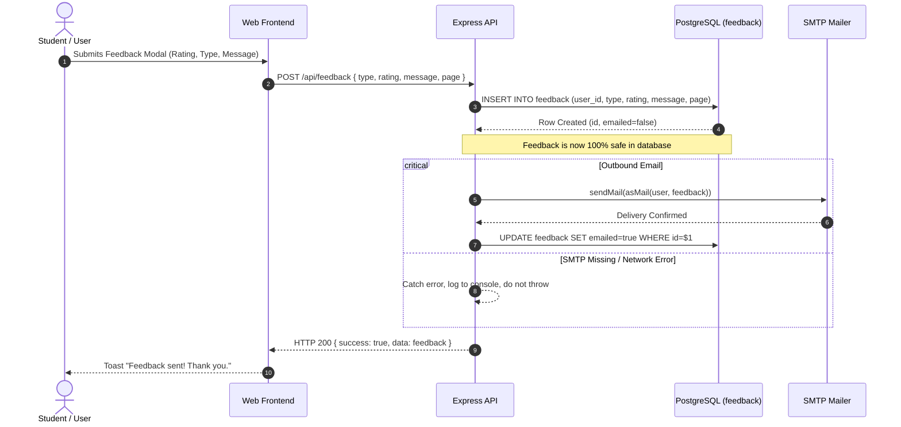

# Feedback Model Documentation

## 1. Overview
The **Feedback** model provides a direct channel for students and household users to submit suggestions, bug reports, feature requests, or general praise directly from within **Hisabki Kitab**.

A key architectural design principle is **Zero User-Friction & Guaranteed Persistence**: feedback is committed to the database *first*, and the outbound notification email to the developer is dispatched *second*. If SMTP credentials are unavailable or the email fails, the feedback row is safely retained and never lost.

---

## 2. Database Schema

### Table: `feedback`
```sql
CREATE TABLE IF NOT EXISTS feedback (
  id          uuid PRIMARY KEY DEFAULT gen_random_uuid(),
  user_id     uuid NOT NULL REFERENCES users(id) ON DELETE CASCADE,
  type        text NOT NULL DEFAULT 'General',
  rating      integer CHECK (rating BETWEEN 1 AND 5),
  message     text NOT NULL,
  page        text NOT NULL DEFAULT '',
  emailed     boolean NOT NULL DEFAULT false,
  created_at  timestamptz NOT NULL DEFAULT now(),
  updated_at  timestamptz NOT NULL DEFAULT now()
);

CREATE INDEX IF NOT EXISTS feedback_created_idx ON feedback (created_at DESC);
CREATE INDEX IF NOT EXISTS feedback_user_idx ON feedback (user_id, created_at DESC);
```

---

## 3. Workflow & Resilience Architecture



---

## 4. Vocabulary & Contract (`vocabulary.json`)

The feedback classification types are governed by `@hisabkikitab/contracts`:
- `Bug`: Technical error, UI malfunction, or broken layout.
- `Feature Request`: New feature proposal (e.g. new payment method, custom split method).
- `Design`: Visual feedback, theme issues, readability improvements.
- `Praise`: Positive user experience note.
- `General`: Unclassified feedback.

### Developer Direct Channels:
When SMTP is unconfigured or for inquiries longer than a form, the modal and footer provide direct contact links:
- **Email**: Defined in `DEVELOPER.email`.
- **LinkedIn**: Developer profile URL.

---

## 5. API Endpoints

| Method | Path | Description | Protected |
|---|---|---|:---:|
| `POST` | `/api/feedback` | Submit new user feedback | Yes |
| `GET` | `/api/feedback/meta` | Get allowed feedback types and developer contact info | No |
| `GET` | `/api/feedback` | List recent feedback submitted by current user (up to 20) | Yes |
