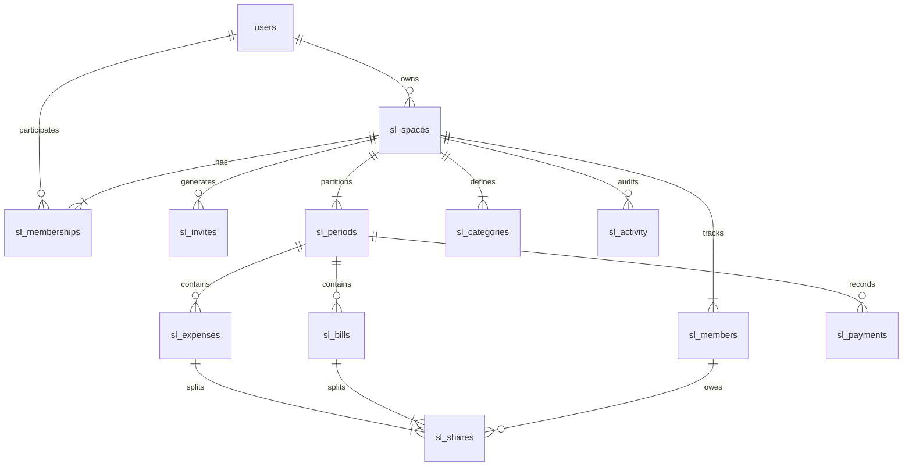

# Shared Living Mode (مشترکہ رہائش / Shared Flat & Hostel Room Ledger)

## 1. Overview & Purpose
**Shared Living Mode** is a dedicated multi-user, space-centric ledger designed for roommates, hostel flatmates, and shared apartment residents in Pakistan.

Instead of managing an individual's personal wallet, Shared Living operates on collaborative shared expenses:
- Splitting shared groceries, drinking water cans, and mess/cook expenses.
- Tracking shared utility bills (electricity, Sui gas, Wi-Fi, generator fuel).
- Recording member contributions and cash advances.
- Computing real-time net balances between residents.
- Enforcing strict mathematical integrity so not a single paisa is lost.

---

## 2. Architecture & Data Isolation

Shared Living is completely segregated from personal accounting:

```
Personal Finance (Student / Householder)   <====== STRICT BARRIER ======>   Shared Living (Shared Space Ledger)
- /api/expenses, /api/income, /api/budget                                   - /api/shared-living/*
- Scoped to user_id & finance_mode                                          - Scoped to space_id & period_id
```

### The Personal Route Guard:
```javascript
// apps/api/src/routes.js
const personalPaths = ['/api/expenses','/api/income','/api/goals','/api/debts','/api/budget','/api/dashboard','/api/ai','/api/reports'];
app.use(personalPaths, protect, (req, res, next) => {
  if (req.user.financeMode === 'shared_living') {
    return res.status(403).json({ success: false, message: 'shared.personalMode' });
  }
  return next();
});
```

---

## 3. Database Entities & Relationships

All Shared Living tables are prefixed with `sl_` and use 64-bit integer minor currency units (`amount_minor bigint` representing paisas/cents):



### Tables Summary:
1. `sl_spaces`: The shared living space (e.g. "Flat 402, G-11 Islamabad"). Stores owner, currency, and resident capacity.
2. `sl_memberships`: Maps authenticated `users` to `sl_spaces` with roles: `admin` or `viewer`.
3. `sl_invites`: Cryptographically secure invite tokens (SHA-256 hash). Allows inviting roommates.
4. `sl_periods`: Monthly accounting cycles (`month date`). Can be marked `closed = true` to prevent historical tampering.
5. `sl_members`: Roommate records inside a space (name, phone, weight, joined_on, left_on, active). Note: Members can exist before creating a web app account.
6. `sl_categories`: Space categories classified into `kind = 'food'` or `kind = 'bill'`.
7. `sl_expenses`: Daily shared purchases (e.g. vegetables, milk, tea).
8. `sl_bills`: Monthly or lump-sum bills (e.g. K-Electric bill, broadband).
9. `sl_shares`: The calculated exact share owed by each member for an expense or bill.
10. `sl_payments`: Payments/contributions made by a member into the shared pool.
11. `sl_activity`: Immutable audit trail logging who changed what, when, and before/after values.

---

## 4. Expense Allocation & Split Algorithms

Implemented in `apps/api/src/modules/sharedLiving/sharedLiving.calculations.js`. 
Uses BigInt arithmetic and the **Largest Remainder Method (Hare-Niemeyer)** to ensure:
$$\sum \text{Member Shares} \equiv \text{Total Expense Amount}$$
Any fractional paisa remaining from division is allocated deterministically to members based on highest remainder, broken by immutable member ID.

### Supported Split Methods:
1. **`equal`**: Divided equally among all eligible active members.
2. **`selected`**: Divided equally among a chosen subset of roommates (e.g. only vegetarians or only AC users).
3. **`weighted`**: Divided according to member weights (e.g., someone occupying a master bedroom pays 1.5x, others pay 1.0x).
4. **`percentage`**: Custom percentages that must sum exactly to 100%.
5. **`custom`**: Explicit paisa amounts assigned per member that must sum exactly to the total.

---

## 5. Mathematical Integrity & Database Triggers

PostgreSQL constraint triggers verify that shares always equal the total amount after any transaction finishes:

```sql
CREATE OR REPLACE FUNCTION sl_check_shares() RETURNS trigger LANGUAGE plpgsql AS $$
DECLARE target uuid; expected bigint; actual numeric; source text;
BEGIN
  IF TG_TABLE_NAME='sl_shares' THEN
    target:=COALESCE(NEW.expense_id,NEW.bill_id,OLD.expense_id,OLD.bill_id);
    source:=CASE WHEN COALESCE(NEW.expense_id,OLD.expense_id) IS NOT NULL THEN 'sl_expenses' ELSE 'sl_bills' END;
  ELSE target:=COALESCE(NEW.id,OLD.id); source:=TG_TABLE_NAME; END IF;
  
  EXECUTE format('SELECT amount_minor FROM %I WHERE id=$1',source) INTO expected USING target;
  SELECT COALESCE(sum(amount_minor),0) INTO actual FROM sl_shares WHERE expense_id=target OR bill_id=target;
  
  IF expected IS NOT NULL AND expected<>actual THEN 
    RAISE EXCEPTION 'Invalid share total' USING ERRCODE='23514'; 
  END IF;
  RETURN NULL;
END $$;

CREATE CONSTRAINT TRIGGER sl_shares_total 
  AFTER INSERT OR UPDATE OR DELETE ON sl_shares 
  DEFERRABLE INITIALLY DEFERRED FOR EACH ROW EXECUTE FUNCTION sl_check_shares();
```

---

## 6. Security, Permissions & Audit Trail

### Role Matrix:
| Capability | Admin | Viewer |
|---|:---:|:---:|
| View Space Dashboard & Reports | Yes | Yes |
| Create / Edit / Delete Expenses | Yes | No |
| Create / Edit / Delete Bills | Yes | No |
| Record Member Payments | Yes | No |
| Add / Edit Members & Weights | Yes | No |
| Generate / Rotate Space Invites | Yes | No |
| Close / Reopen Monthly Period | Yes | No |
| View Receipt Attachments | Yes | Yes |
| Transfer Space Ownership | Owner Only | No |

### Period Closing Invariant:
Once a month's ledger is finalized, admins can lock the period (`closed = true`). When closed:
- No new expenses, bills, or payments can be entered for that month.
- Existing items cannot be updated or deleted.
- Only an admin can explicitly reopen the period.

---

## 7. Frontend User Experience
- **Dashboard**: `SharedLivingPage.jsx` renders a comprehensive multi-tab interface:
  - Space switcher & monthly cycle selector.
  - Financial health header: Total Spent, Remaining Budget, Cash in Hand, Outstanding Dues.
  - Member Ledger: Who owes what, net balances, payment status.
  - Expense & Bill creation modal with real-time split preview.
  - Receipt preview dialog with strict Content-Security-Policy sandbox.
  - Activity log showing chronological change history.
